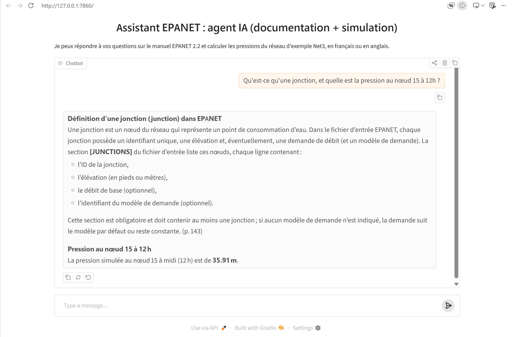

# EPANET Assistant — RAG and Tool-Calling Agent for Hydraulic Simulation

Personal project · NLP / LLM agents · Python · LangChain · ChromaDB · WNTR · Gradio

## Project overview

This project is a prototype assistant for users of **EPANET**, the U.S. EPA software for simulating water distribution networks.



It combines two capabilities behind a single chat interface:

- **Documentation search (RAG):** answering questions about EPANET from the official *EPANET 2.2 User Manual*, with page references;
- **Scientific computation (tool calling):** running a hydraulic simulation of an example network with WNTR and returning computed pressures.

An LLM acts as an **agent**: for each question, it decides whether to search the documentation, run the simulation, do both, or answer directly. The aim was to explore how an LLM can help users learn and use a scientific simulation tool without inventing technical content or numerical values.

## Research question

Can a small LLM agent reliably choose between a documentation tool and a simulation tool, and combine their results into a grounded answer?

The project was built in three steps:

1. A RAG pipeline over the EPANET manual (`rag.py`);
2. A chat interface with Gradio (`app.py`);
3. An agent with two tools and an agent loop (`agent.py`).

## Architecture

```
                     User question (FR or EN)
                               |
                               v
                     LLM agent (gpt-oss-120b)
                 decides which tool(s) it needs
                               |
            +------------------+------------------+
            |                                     |
            v                                     v
   chercher_documentation                  pression_noeud
            |                                     |
            v                                     v
  Multilingual embeddings              WNTR / EPANET simulator
  + ChromaDB retriever (k=3)             on the Net3 network
            |                                     |
            v                                     v
   Manual passages with                Pressure at a node
      page numbers                      at a given hour (m)
            |                                     |
            +------------------+------------------+
                               |
                               v
               Tool results sent back to the LLM
         (loop repeated until no more tools are needed,
                       maximum 5 rounds)
                               |
                               v
             Final answer with page references
```

## Implementation

### Documentation pipeline (`rag.py`)

- Loads the *EPANET 2.2 User Manual* with `PyPDFLoader` and keeps the pages from Chapter 1 onwards (176 pages);
- Splits them into 476 chunks with `RecursiveCharacterTextSplitter` (`chunk_size=800`, `chunk_overlap=100`), keeping page metadata;
- Embeds the chunks with the multilingual model `paraphrase-multilingual-MiniLM-L12-v2`, so that French questions can retrieve passages from the English manual;
- Stores them in an in-memory ChromaDB vector store and retrieves the 3 closest chunks per question;
- Asks the LLM to answer only from the retrieved context, in the language of the question, and to reply "I don't know" when the answer is not in the documentation.

### Simulation tool (`agent.py`)

- Loads the example network **Net3** (97 nodes, 117 pipes) with WNTR;
- Runs one hydraulic simulation at start-up with `EpanetSimulator`;
- Exposes `pression_noeud(noeud, heure)`, which returns the pressure (in metres) at a node and hour, and returns an explicit message when the node or hour does not exist.

### Agent (`agent.py`)

- Each tool is described to the LLM with a JSON Schema (`name`, `description`, `parameters`);
- A system prompt defines the assistant's role, asks it to cite pages, forbids invented numerical values, and limits repeated searches;
- An **agent loop** sends the conversation to the LLM, executes the requested tools, returns their results, and repeats until the LLM produces a final answer (maximum 5 rounds, as a safeguard against endless tool calls).

### Interface (`app.py`)

- A `gr.ChatInterface` connected to the agent, with three example questions;
- A post-processing step that normalises the model's citation formats to `(p. X)`, the format requested in the system prompt.

### LLM provider

The code uses the **OpenAI-compatible API** format, so changing LLM provider only requires changing the base URL, the API key and the model name. During development, the project moved from Hugging Face Inference Providers to Groq without changing the agent logic. The current configuration uses `openai/gpt-oss-120b` on Groq.

Because `gpt-oss-120b` is a reasoning model, its reasoning tokens count towards `max_tokens`; the limit was therefore raised to 1500 to avoid truncated answers.

## Repository structure

```
.
├── rag.py               # RAG pipeline (loading, chunking, embeddings, retriever)
├── agent.py             # Tools, tool descriptions and agent loop
├── app.py               # Gradio chat interface
├── test_wntr.py         # Minimal WNTR simulation check
├── liste_modeles.py     # Lists the models available from the LLM provider
├── epanet_manuel.pdf    # EPANET 2.2 User Manual (U.S. EPA)
├── Net3.inp             # Example network (from the WNTR repository)
├── requirements.txt
├── .env.example
└── .gitignore
```

## Run the project

Create and activate a virtual environment, then install the dependencies:

```
python -m venv .venv
.venv\Scripts\activate          # Windows
python -m pip install -r requirements.txt
```

Create a `.env` file from `.env.example` and add a Groq API key:

```
GROQ_API_KEY=your_key_here
```

Run each component:

```
python rag.py      # RAG tests in the terminal
python agent.py    # agent tests in the terminal
python app.py      # chat interface at http://127.0.0.1:7860
```

## Manual tests

The following questions were tested in the terminal and in the Gradio interface:

| Question | Tool(s) called by the agent | Result |
|---|---|---|
| À quoi sert EPANET ? | `chercher_documentation` (query translated to English by the agent) | Correct answer in French, with page reference (p. 1) |
| Quelle est la pression au nœud 10 à 6h ? | `pression_noeud` | 29.10 m, from the simulation |
| Qu'est-ce qu'une jonction, et quelle est la pression au nœud 15 à 12h ? | `chercher_documentation`, then `pression_noeud` | Definition from the manual (p. 52, p. 143) and 35.91 m, combined in one answer |
| Bonjour, qui es-tu ? | none | Direct answer describing the assistant and its two tools |
| Quelle est la capitale de la France ? (RAG only) | — | "Je ne sais pas, cette information n'est pas dans la documentation." |

These are manual checks on a handful of questions, not a systematic evaluation.

## What we learned

- **Data coverage matters as much as the agent.** In an earlier version indexing only Chapters 1–2, the agent searched four times for the definition of a junction and reached the 5-round limit. The definition was in a chapter that had not been indexed. Indexing the full manual solved the problem; the agent's behaviour had been reasonable.
- **The agent loop needs a safeguard.** Without a maximum number of rounds, an agent that keeps calling tools would run indefinitely and consume API quota.
- **Prompt instructions are not always followed.** Despite an explicit instruction, the model used several citation formats (`【page 143】`, `[page 52]`, `(p. 1)`). A deterministic post-processing step is more reliable than the prompt alone.
- **Explicit instructions work better than general ones.** "Answer in the language of the question" was ignored when the prompt itself was in French; an explicit rule with examples fixed it.
- **Retrieval always returns something.** The retriever returns the k closest chunks even for unrelated questions, so the sources displayed are not necessarily relevant.

## Technologies

- Python 3
- LangChain (document loading, text splitting)
- Sentence Transformers (multilingual embeddings)
- ChromaDB (vector store)
- WNTR and the EPANET engine (hydraulic simulation)
- OpenAI-compatible API, Groq, `gpt-oss-120b` (LLM and tool calling)
- Gradio (chat interface)
- python-dotenv (API key management)

## Data and licensing

- The *EPANET 2.2 User Manual* is published by the U.S. Environmental Protection Agency.
- `Net3.inp` is one of the EPANET example networks distributed with WNTR.
- No personal data is used. API keys are kept in a local `.env` file, which is excluded from the repository.

## Limitations and future work

- **No systematic evaluation yet.** A test set of questions with reference pages would allow measuring retrieval quality (for example, how often the correct page is among the retrieved chunks) and the agent's tool selection.
- **Sources in `rag.py`** are the pages retrieved by the retriever, not necessarily the pages used by the model. A similarity threshold would avoid returning unrelated chunks.
- **The "I don't know" detection in `rag.py`** only checks for the French sentence, so it does not handle answers in English.
- **PDF extraction artefacts** (for example `T utorial`, `EP ANET`, ligatures such as `fi`) are not cleaned yet; Unicode normalisation (NFKC) and a different PDF extractor could improve retrieval.
- **No conversation memory:** each message is treated independently, and short messages such as "super" or "merci" are handled as documentation questions in the RAG version.
- **One simulation tool only:** pressures on the Net3 network, at whole hours. Future tools could cover flows, water quality, detection of negative pressures, or user-provided `.inp` files.
- **The vector store is rebuilt at each start-up.** Persisting ChromaDB on disk would reduce start-up time.
- **Retrieval could be improved** with hybrid search (BM25 + embeddings), a reranker, or a comparison of embedding models, measured with the evaluation set.
- `langchain-community` is being deprecated; the loader should be migrated to a dedicated integration package.

## Credits

Personal project by **Zohré Shafiee**, Master's student in Sciences du langage — Industrie de la langue (NLP), Université Grenoble Alpes, 2026.
